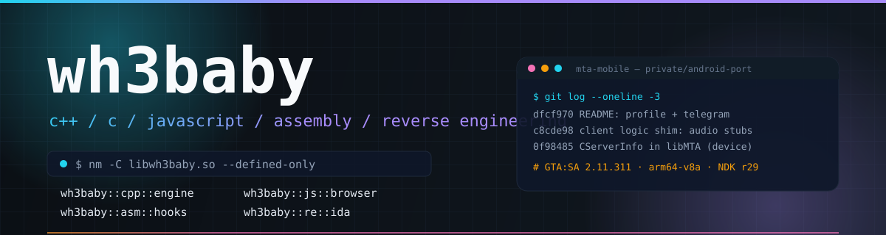
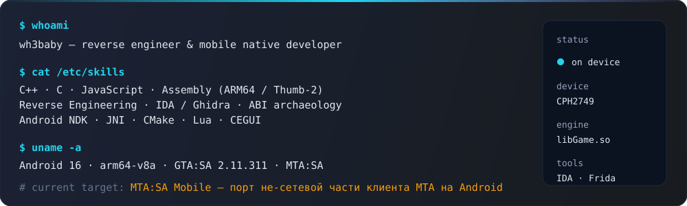

  
  
  

<h3><code>&nbsp;// stack&nbsp;</code></h3>

  
  
  
  
  

  
  
  
  
  
  

  
  
  
  
  

<h3><code>&nbsp;// whoami&nbsp;</code></h3>

<h3><code>&nbsp;// featured&nbsp;</code></h3>

  
  
  

<h3><code>&nbsp;// devices&nbsp;</code></h3>

<table width="92%">
  <tr><th align="left"><code>phone</code></th><td>OPPO CPH2749 — Android 16, arm64-v8a (MTA mobile test device)</td></tr>
  <tr><th align="left"><code>tools</code></th><td>Android SDK · NDK r29 · IDA Pro · Ghidra · Frida · adb</td></tr>
  <tr><th align="left"><code>os</code></th><td>Windows 11</td></tr>
  <tr><th align="left"><code>focus</code></th><td>GTA:SA mobile internals · MTA client port · native Android</td></tr>
</table>

<h3><code>&nbsp;// telemetry&nbsp;</code></h3>

  
  

